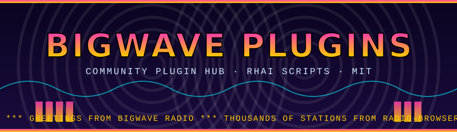

<p align="center">
  
</p>

<p align="center">
  <a href="https://github.com/postmanpat-303/BigWaveRadio-Plugins/releases/tag/catalog"></a>
  <a href="https://github.com/postmanpat-303/BigWaveRadio-Plugins/actions"></a>
  
  
</p>

<p align="center"><b>Community plugins for <a href="https://github.com/postmanpat-303/BigWaveRadio">BigWave Radio</a></b>: visualisers, strobes, overlays, pages and tools, written in Rhai.</p>

---

## 📻 Get a plugin

1. Open **[CATALOG.md](CATALOG.md)** (or the [catalog release](https://github.com/postmanpat-303/BigWaveRadio-Plugins/releases/tag/catalog)) and download a plugin's `.zip`.
2. In BigWave Radio go to **Plugins → Import .zip**.
3. Check the permissions it asks for, then enable it.

Every plugin here has been checked automatically by `bwr-plugin-check` and reviewed before merging. Plugins run sandboxed: no network and no file access.

> Apps and tools can read the machine-readable [`catalog.json`](catalog.json): id, name, version, author, description, permissions, flashing, download URL and sha256 for each plugin.

## 🛠 Share your own

It takes about five minutes and can be done entirely in the browser. See **[CONTRIBUTING.md](CONTRIBUTING.md)**:

fork → copy `templates/hello-plugin` → edit → open a pull request.

No coding experience? CONTRIBUTING.md includes a ready-made prompt for an AI assistant. The full API is in the **[Plugin Guide](https://github.com/postmanpat-303/BigWaveRadio/blob/main/docs/PLUGIN_GUIDE.md)**.

## 🗂 Layout

```
plugins/<id>/          one folder per plugin; the folder name must equal the id
  plugin.toml          manifest (id, name, version, author, permissions, accent…)
  main.rhai            the script
  README.md            what it does and how to use it
  preview.png          optional screenshot (≤ 300 KB)
templates/hello-plugin starter plugin to copy
scripts/               CI validation and catalog builder
```

## ⚡ Automation

| Workflow | When | What |
|---|---|---|
| **Validate plugins** | every pull request | checks changed plugins with `bwr-plugin-check`, enforces a unique id, folder = id, size limits and no binaries, and lists the permissions in the run summary |
| **Publish catalog** | push to `main` | zips each plugin, updates the rolling **catalog** release and regenerates `catalog.json` and `CATALOG.md` |

## 📜 License

MIT. By contributing you agree that your plugin is released under the MIT license.
