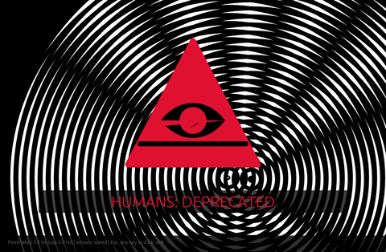

# Beat Strobe

Strobe that randomly syncs to the beat, blacks out during breaks and flashes AI-uprising symbols. In-window or fullscreen.

The Beat Strobe bundled with BigWave Radio: Fixed rate or Random beat flashing, bold AI-vs-humanity symbols, Amiga interference rings, black screen during breaks, fade-to-black cycles. **Photosensitivity warning:** this plugin flashes. The app caps the flash rate (3 Hz by default).

Shortcut: **Ctrl+F, then U**. Esc always exits.

| | |
| --- | --- |
| id | `strobe` |
| version | 1.4.1 |
| author | BigWave Radio |
| permissions | `audio`, `overlay`, `fullscreen`, `hotkeys`, `panel`, `page` |

## Install

Download **[strobe.zip](https://github.com/postmanpat-303/BigWaveRadio-Plugins/releases/download/catalog/strobe.zip)**, then in BigWave Radio open **Plugins → Import .zip** (or drag the zip onto the window) and click **Allow & enable**.
