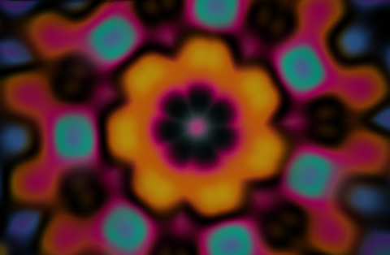

# Visions

MilkDrop-style audio visualiser: feedback tunnel, kaleidoscope, plasma, flow field, wireframe sphere, spectrum terrain, starfield and mandala, with smooth crossfades. Non-strobing.

The MilkDrop-style visualiser bundled with BigWave Radio: eight scenes (feedback tunnel, kaleidoscope, plasma, flow field, wire sphere, spectrum terrain, starfield, mandala) with smooth crossfades, built on `draw.visual`. Non-strobing.

Shortcut: **Ctrl+M, then D**. Left / Right switch scene, Esc exits.

Needs BigWave Radio **0.8 or later** (for `draw.visual`).

| | |
| --- | --- |
| id | `visions` |
| version | 1.0.1 |
| author | BigWave Radio |
| permissions | `audio`, `overlay`, `fullscreen`, `hotkeys`, `panel`, `page` |

## Install

Download **[visions.zip](https://github.com/postmanpat-303/BigWaveRadio-Plugins/releases/download/catalog/visions.zip)**, then in BigWave Radio open **Plugins → Import .zip** (or drag the zip onto the window) and click **Allow & enable**.
